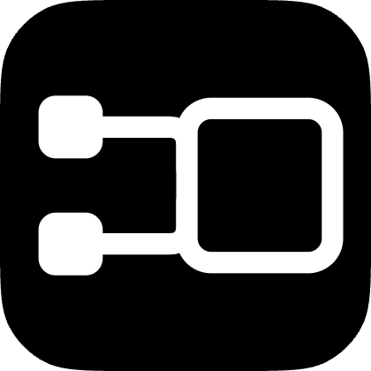
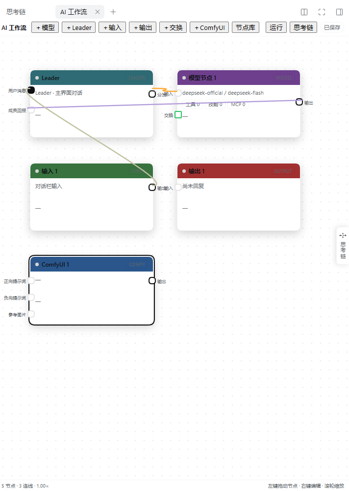
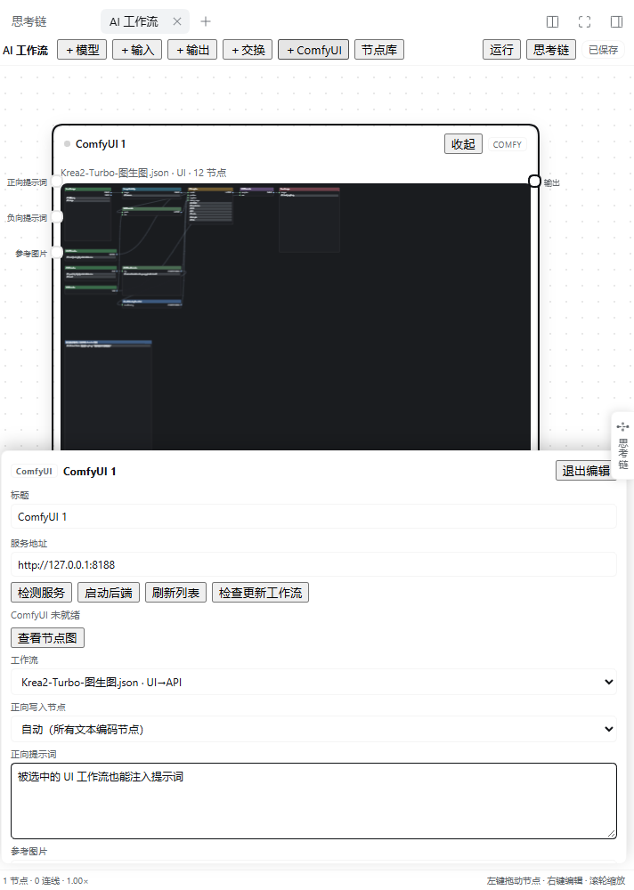

<div align="center">



# dsh-ai-workflow

**A ComfyUI-style canvas inside the DeepSeek Harness right sidebar: wire agents, models, chat I/O and ComfyUI workflows into one graph and run it.**

[](LICENSE)
[](package.json)
[](test)
[](https://github.com/deepseek-ai)

[中文](README.zh.md)

</div>



---

## What it is

A DSH plugin that adds a second sidebar tab. The tab is a pannable, zoomable canvas where every box is something that can run: a model call, an agent member, a ComfyUI workflow, the chat composer, the chat reply.

- **Nodes are agents.** A model node carries its own provider/model, tools, skills, MCP servers and prompt, and runs with an isolated context.
- **The leader *is* the chat.** Drop one leader node in and it dispatches the conversation to its members, then collects what they return and posts the combined answer back to the chat.
- **ComfyUI is first-class.** Local workflows are listed, converted to a runnable graph, drawn inside the card with litegraph semantics, and their images can feed a vision model.

## Install

Prerequisites: a DSH profile with the right sidebar bundle (`@deepseek-ai/dsh-client-ui-sidebar-right`) and at least one model provider.

```bash
# from the profile folder
pnpm add link:<path-to-this-repo>
```

Then add the bundle to the profile's `package.json`:

```json
{
  "dsh": { "profile": { "bundles": ["dsh-ai-workflow"] } }
}
```

Restart the app (or toggle the plugin), click the pill on the right edge of the window, and the **AI workflow** tab opens.

## Node kinds

| Node | What it does | Ports |
|---|---|---|
| **Leader** | Is the conversation: takes the user message, dispatches it, collects member results, publishes the reply | user message · member results (in), dispatch (out) |
| **Input** | Reads the newest text from the main composer | out |
| **Output** | Whatever arrives becomes the main-chat reply (text and images) | in |
| **Model** | One agent member: provider/model, tools, skills, MCP, own prompt | in · exchange (in/out), out |
| **Exchange** | Follows its own prompt to collect upstream output, rewrite it, route it to named targets | in, dispatch |
| **ComfyUI** | Runs a local ComfyUI workflow; positive/negative prompts and a reference image can be injected | positive · negative · reference (in), out |

### Three rules

- **Isolated context.** Every model node starts from its own system prompt and message array; another node only sees the text an edge carries. Nothing leaks between members.
- **Reloaded every round.** A node's prompt, tools, skills and MCP list are re-read from disk on each run, so an edit applies to the next run — nothing is cached across runs.
- **The leader has two inputs.** One pipeline carries the user message, the other carries member results; member edges never join the execution order, so a leader → members → leader graph cannot deadlock or loop.

## ComfyUI bridge



- Scans the three standard workflow folders, so both UI-format and API-format JSON are listed.
- UI workflows are converted to a runnable graph through `/object_info` widget order; dynamic combos are filled with a valid default, so `/prompt` accepts the job.
- The saved graph is drawn in the card with litegraph semantics: title-bar category colors, typed sockets, widgets, bezier links. Click a node in the card to pick it as the injection target.
- Images come back as attachments, so they can be handed to a vision model downstream.
- The inspector can start a local ComfyUI backend, refresh the list, re-check for updated workflows, and preview the exact payload before submitting.

## Storage

One file per conversation, so a graph belongs to the chat it was drawn in:

```
<workspace>/dsh-workflows/<session-id>/main.json
```

The panel autosaves; editing the file by hand is allowed and picked up on reload.

## Tests

```bash
node --test test/workflow.test.mjs   # 24/24
```

They cover graph normalisation and topology, per-node context isolation, the exchange node's routing, the input/output round trip, both leader pipelines, and the per-round reload of prompts and skills.

## Structure

| File | Role |
|---|---|
| `index.js` | Host half: registers `/api/ai-workflow` routes. |
| `workflow.js` | Graph store, node execution, provider calls, tool loop, ComfyUI scan/convert/run, publish back to chat. |
| `client.js` | Browser half: the canvas, cards, inspector, litegraph renderer, edge pill. |
| `cordis.patch.yml` | Bundle entry for the profile loader. |

## Known limits

- The ComfyUI node needs a running backend (`http://127.0.0.1:8188` by default); the inspector reports when it is not ready.
- Only one leader node may exist per graph — it represents the conversation.
- Live per-node highlighting during a ComfyUI run relies on polling, not the ComfyUI WebSocket.

## License

GPL-3.0-or-later. See [LICENSE](LICENSE).