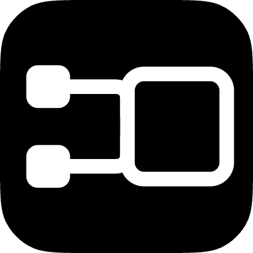
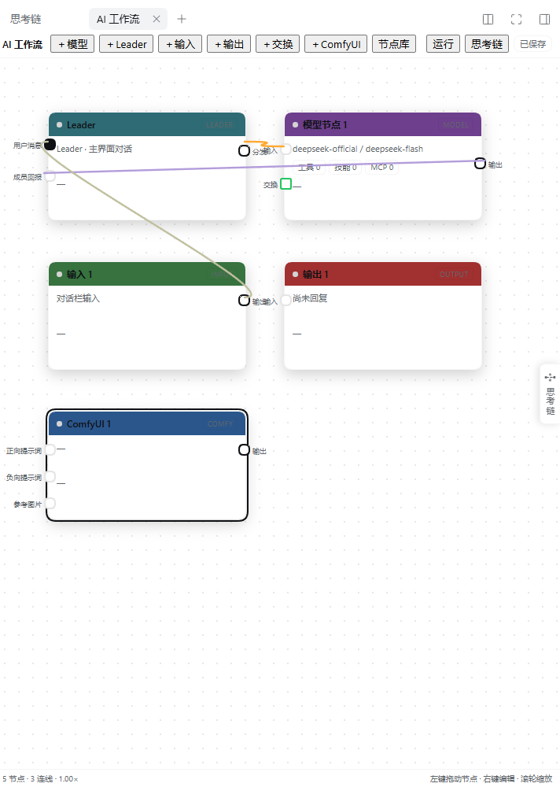
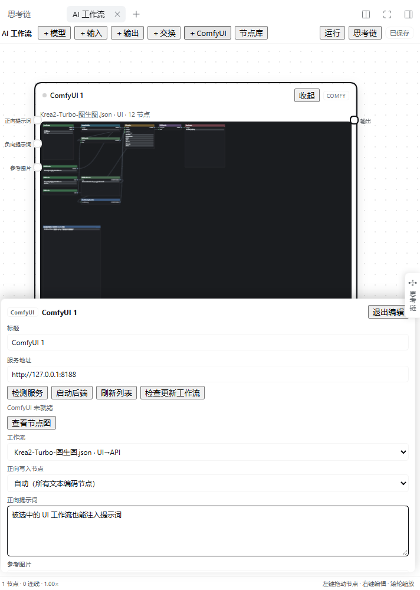

<div align="center">



# dsh-ai-workflow

**在 DeepSeek Harness 右侧栏里放一张 ComfyUI 式画布：把智能体、模型、对话出入口和 ComfyUI 工作流接成一张图并运行。**

[](LICENSE)
[](package.json)
[](test)
[](https://github.com/deepseek-ai)

[English](README.md)

</div>



---

## 它是什么

一个 DSH 插件，给右侧栏加第二个标签页。标签页是一张可拖动缩放的画布，每个方块都是能跑的东西：一次模型调用、一个智能体成员、一个 ComfyUI 工作流、对话输入栏、对话回复。

- **节点就是智能体。** 模型节点自带 provider/model、工具、skill、MCP 和自己的提示词，运行时上下文互相隔离。
- **Leader 就是这场对话。** 放一个 Leader 节点，它把对话派给成员，收集成员回报，再把汇总结果发回主界面。
- **ComfyUI 是一等公民。** 本机工作流会自动列出、转成可执行图、用 litegraph 语义画在卡片里，出的图还能喂给视觉模型。

## 安装

前提：DSH 带右侧栏插件（`@deepseek-ai/dsh-client-ui-sidebar-right`），并且至少配好一个模型 provider。

```bash
# 在 profile 目录下
pnpm add link:<这个仓库的路径>
```

再把 bundle 加进 profile 的 `package.json`：

```json
{
  "dsh": { "profile": { "bundles": ["dsh-ai-workflow"] } }
}
```

重启应用（或在插件里启用一次），点窗口右边缘的胶囊按钮，就打开「AI 工作流」标签页。

## 六类节点

| 节点 | 作用 | 端口 |
|---|---|---|
| **Leader** | 就是这场对话：接过用户消息、派单、收集成员结果、发出回复 | 用户消息 / 成员回报（入）、分发（出） |
| **输入** | 取主界面对话栏最新文字 | 出 |
| **输出** | 收到什么就作为主界面回复发出去（文本与图片） | 入 |
| **模型** | 一个智能体成员：provider/model、工具、skill、MCP、自己的提示词 | 入 · 交换（进/出）、出 |
| **交换** | 按自己的提示词收集上游、改写、按目标分发 | 入、分发 |
| **ComfyUI** | 跑本机 ComfyUI 工作流，可注入正向/负向提示词与参考图 | 正向 · 负向 · 参考图（入）、出 |

### 三条关键约定

- **上下文隔离。** 每个模型节点都从自己的 system 提示词和消息数组起步，别的节点只能看到连线上带过来的那段文字，成员之间互不泄漏。
- **每轮重新加载。** 节点的提示词、工具、skill、MCP 列表每次运行都重新从磁盘读取，改完下一次运行就生效，不跨轮缓存。
- **Leader 有两条入管线。** 一条走用户消息，一条收成员回报；指向 Leader 的成员边不参与执行顺序，所以 Leader → 成员 → Leader 不会成环或死锁。

## ComfyUI 桥



- 扫描本机三个工作流目录，UI 格式与 API 格式的 JSON 都会列出。
- UI 工作流经 `/object_info` 的 widget 顺序转成可执行图，动态下拉自动填合法默认值，`/prompt` 才不会因为缺参数报 400。
- 存档里的真实节点图用 litegraph 语义画在卡片中：标题栏分类配色、带类型的插槽、widget、贝塞尔连线。点卡片里的节点即可把它设为注入目标。
- 图片以附件形式回传，可以继续交给下游视觉模型。
- 检查器能启动本地 ComfyUI 后端、刷新列表、检查工作流更新、预览将提交的 payload。

## 存储

一场对话一个文件，图属于它被画在的那场对话：

```
<工作区>/dsh-workflows/<会话 id>/main.json
```

面板自动保存；手改这个文件也可以，重新加载即生效。

## 测试

```bash
node --test test/workflow.test.mjs   # 24/24
```

覆盖图规范化与拓扑、节点上下文隔离、交换节点分发、输入/输出闭环、Leader 两条管线、以及提示词与 skill 的每轮重载。

## 结构

| 文件 | 作用 |
|---|---|
| `index.js` | Host 半边：注册 `/api/ai-workflow` 路由。 |
| `workflow.js` | 图存储、节点执行、模型调用、工具循环、ComfyUI 扫描/转换/运行、把结果发回对话。 |
| `client.js` | 浏览器半边：画布、卡片、检查器、litegraph 渲染器、边缘胶囊。 |
| `cordis.patch.yml` | 给 profile loader 的 bundle 条目。 |

## 已知限制

- ComfyUI 节点需要后端在跑（默认 `http://127.0.0.1:8188`），没就绪时检查器会提示。
- 一张图只允许一个 Leader 节点——它代表这场对话。
- ComfyUI 运行中的节点高亮靠轮询，没有接原生 WebSocket。

## 许可证

GPL-3.0-or-later，全文见 [LICENSE](LICENSE)。